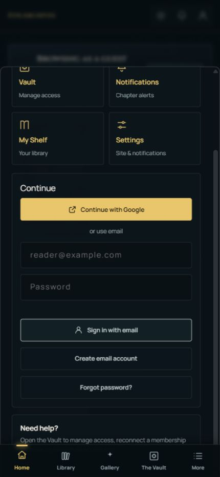
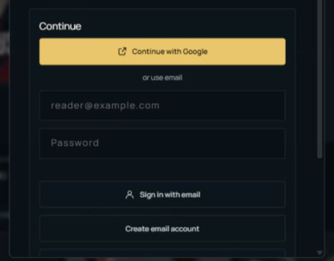
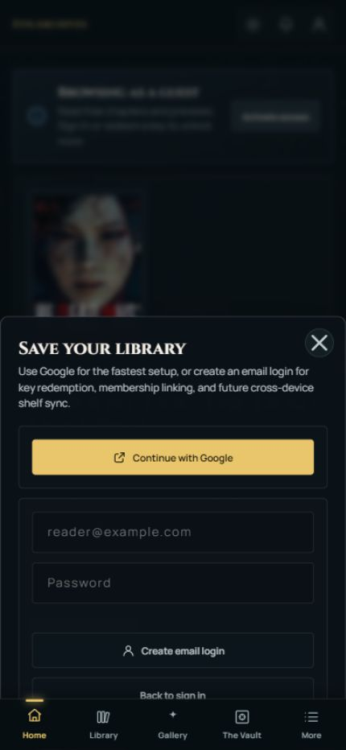
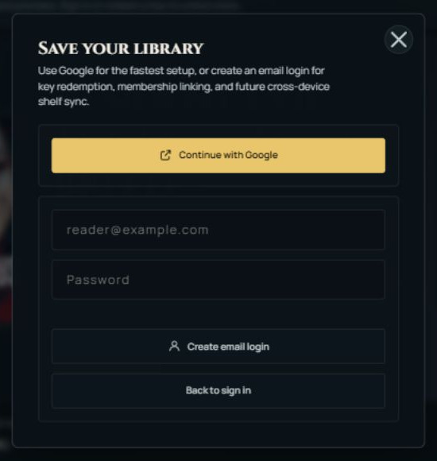
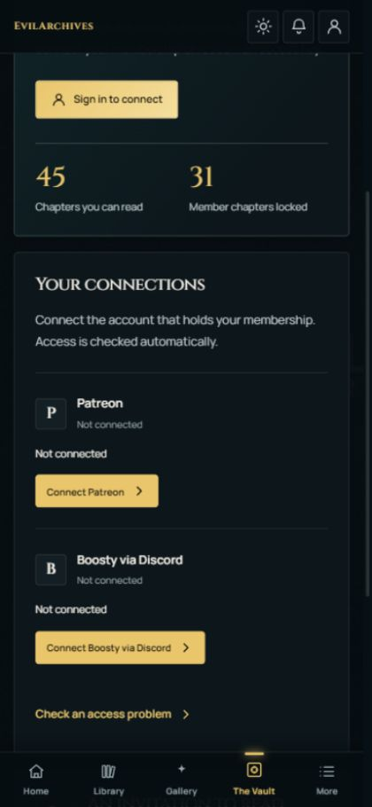
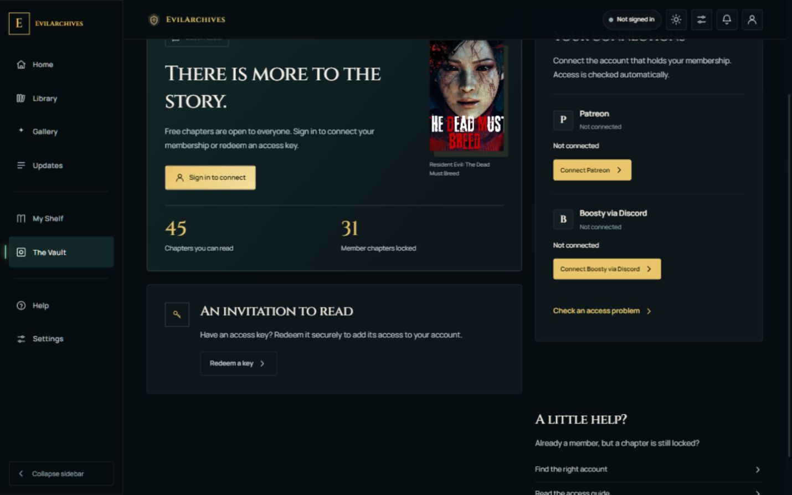
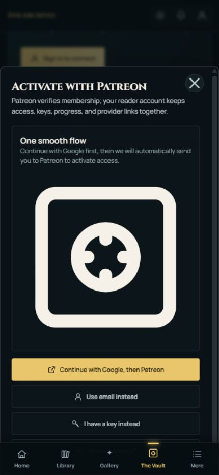
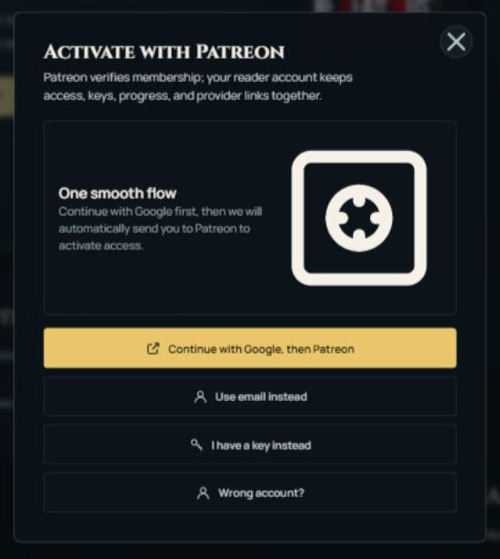

# How to Create Your EvilArchives Reader Account

Free chapters are open to everyone. To save your account, redeem an access key, or connect a membership for locked chapters, open **[EvilArchives](https://cornyshitler.pages.dev/)**.

## 1. Open Account

Select the **person icon in the top-right corner**. The Account panel offers Google and email sign-in. If you want a new email login, select **Create email account**.

| Mobile view | Desktop view |
|---|---|
|  |  |

## 2. Create your reader account

For the quickest setup, select **Continue with Google**. For email, enter your address and password in **Save your library**, then select **Create email login**. If a confirmation email arrives, follow its link before signing in. Already registered? Use **Back to sign in** instead.

| Mobile view | Desktop view |
|---|---|
|  |  |

## 3. Open The Vault

Your reader account alone does **not** unlock member chapters. Open **The Vault**—in the bottom navigation on mobile or the left sidebar on desktop—and select **Connect Patreon** under **Your connections**.

| Mobile view | Desktop view |
|---|---|
|  |  |

## 4. Connect the Patreon account with your membership

If you are not signed in, **Continue with Google, then Patreon** takes you through both steps. Prefer email? Select **Use email instead**, sign in or create your reader account, then return to **The Vault → Connect Patreon**. At Patreon, use the account that holds your membership. When you return, check your access in The Vault. A linked Patreon account unlocks chapters only when an active membership matches a site tier.

| Mobile view | Desktop view |
|---|---|
|  |  |

## Have an access key or need help?

In **The Vault**, choose **Redeem a key** if you have one. Boosty supporters can use **Connect Boosty via Discord** instead. If chapters stay locked, use **Find the right account** or **Check an access problem** in The Vault. For an email-login problem, select **Forgot password?** in Account.

*Screenshots show the guest view. Labels may differ after you sign in. Never share your password or access key in a public comment.*
